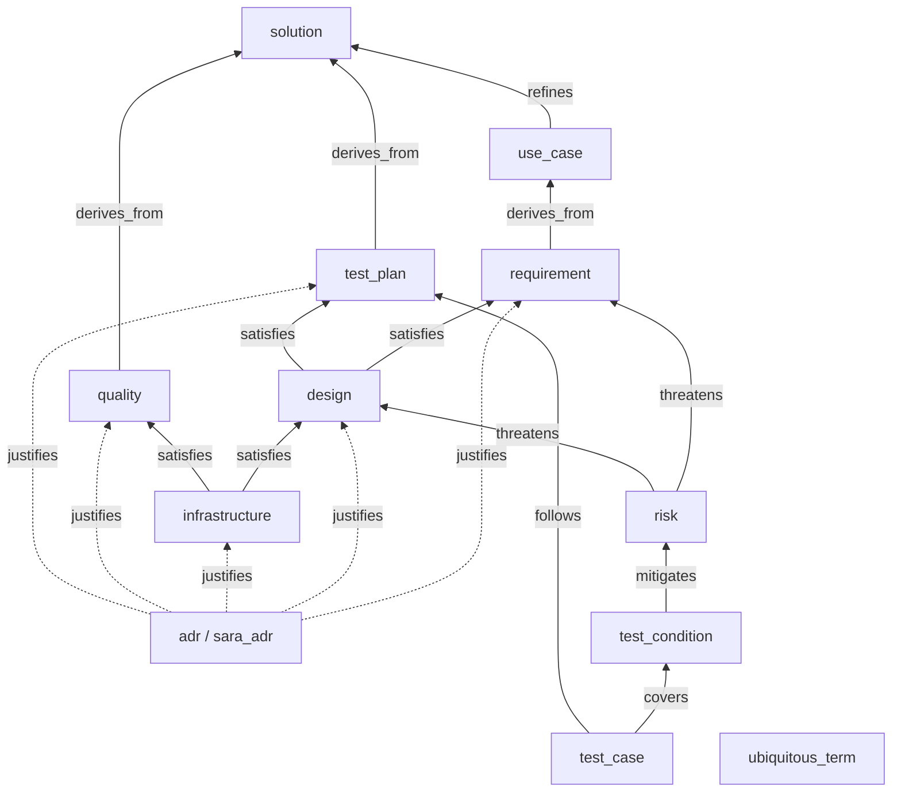
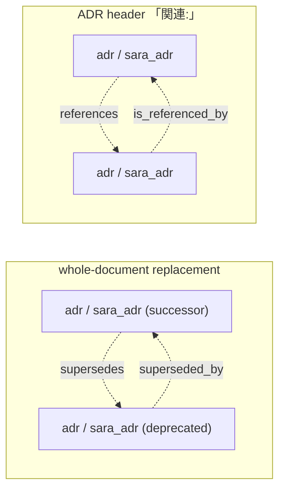

# Sara Document Graph

A reading aid for this repo's sara knowledge graph (`docs/model.yaml`, validated by
`sara check`): the type graph in two figures, and an index of the quality items that hold the
conventions the model schema itself cannot enforce (→ [Norms for placing and writing items](#norms-for-placing-and-writing-items)).
What each type, field and relation in the schema means is explained in [`docs/model.md`](../model.md).

## The type graph at a glance

Every type and every primary (upstream) relation `docs/model.yaml` defines, in one figure.
The YAML is the single source of truth; this figure is a hand-maintained reading aid, so a
change touching `item_types` or `allowed_targets` updates it in the same commit. Nothing
mechanical detects drift — upheld by review.

Solid arrows point from an item to its parent side; the only roots are `solution`,
the two ADR types and `ubiquitous_term`, which has no relation at all and stands alone. Dotted arrows are `justifies`, which ties the otherwise-independent ADR roots into
the tree (one edge minimum per ADR — an ADR without one is an orphan warning). Two
families of relations are deliberately absent from the figure: the peer `depends_on`
(`requirement`, `design`, `quality`, `test_plan` and `infrastructure` may each depend on
an item of their own type), and the downstream inverses (`is_refined_by`, `derives`, …),
which mirror the primary direction one-to-one.

ADR-to-ADR peer relations are drawn separately (rules in [設計判断は ADR に記録し、改訂の書き戻しと item への接続を同じ変更の中で完了させる](../quality/adr-decisions-recorded-and-connected.md), their
mapping to the ADR document in `docs/adr/README.md`). `supersedes` replaces a whole ADR,
whose status becomes `deprecated`:

## Norms for placing and writing items

Each convention is a `quality` item; its `specification` states the norm and its body holds the
guidance for applying it.

- Which type a norm belongs to (`requirement`, `quality` or `test_plan`): [規範の型は、それが誰を縛るかで決める](../quality/norm-type-by-who-it-binds.md)
- Where a risk attaches (`requirement` or `design`): [risk はまず requirement に張り、設計を差し替えると消える懸念だけを design に張る](../quality/risk-attaches-to-requirement-by-default.md)
- How a risk is scored: [risk の level は likelihood と impact から導き、手で決めない](../quality/risk-level-derived-from-likelihood-and-impact.md)
- How an item states its norm: [specification は SHALL 系で書き、日本語の規範文は同じ強度の規範助動詞で終える](../quality/specification-shall-family-and-matching-auxiliaries.md)
- The granularity of test items: [テスト系 item は、テスト資産・検証テーマ・脅威の 3 段の粒度で起こす](../quality/test-items-three-tier-granularity.md)
- Where full IDs go and how prose refers to an item: [フル ID は frontmatter だけに書き、散文では item にリンクで触れる](../quality/full-ids-in-frontmatter-links-in-prose.md)
